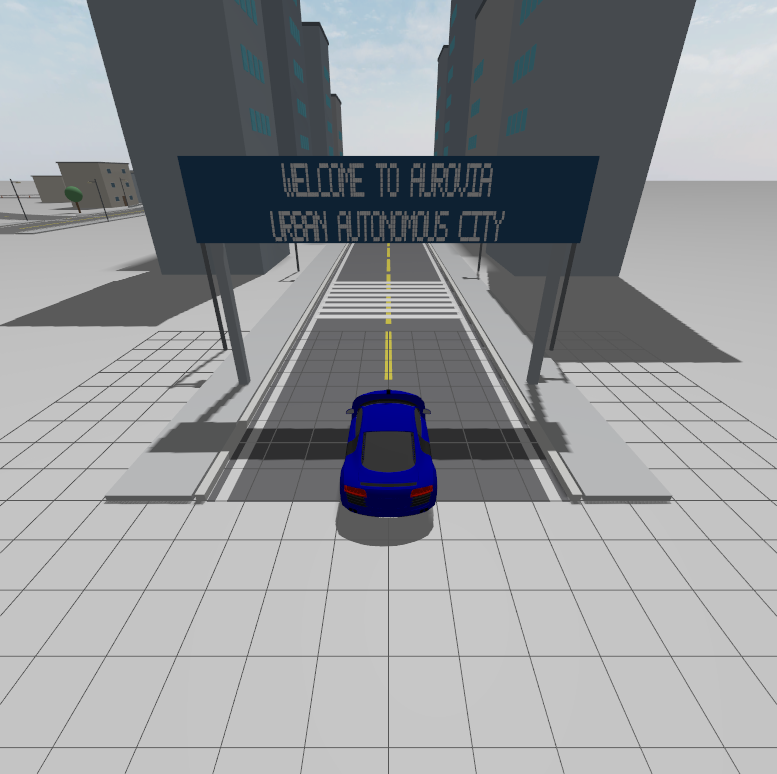

# AUROVIA
### Autonomous Vehicle Simulation in a Smart Urban Environment

<p align="center">
  
</p>

<p align="center">
  <strong>Autonomous Mobility · Ackermann Vehicle Control · Smart Urban Infrastructure</strong>
</p>

<p align="center">
  <em>A ROS 2 and Gazebo simulation platform for autonomous vehicle development and urban mobility experimentation.</em>
</p>

---

## Overview

**AUROVIA** is an autonomous vehicle simulation project built with **ROS 2 Lyrical** and **Gazebo**. It brings together an Ackermann-steered vehicle, a purpose-built multi-zone urban environment, vehicle sensors, traffic-light infrastructure, custom lighting systems and autonomous navigation software.

The project is designed as an integrated engineering environment: the vehicle does not simply move through a static scene. It interacts with a road network, receives simulated sensor data, responds to traffic signals and uses autonomous control components to follow routes and react to obstacles.

AUROVIA provides a practical foundation for exploring automotive engineering, robotics, autonomous mobility and intelligent transportation systems.

## At a glance

| Area | Project capability |
|---|---|
| Vehicle platform | Ackermann-steered vehicle with forward/reverse, steering and braking |
| Operating modes | Manual and autonomous control |
| Navigation | Road-network-based route following and goal-based navigation |
| Environment | Eight urban zones, including an intersection and flyover |
| Traffic interaction | Traffic-light-aware stopping and proceeding behaviour |
| Perception sensors | LiDAR and vehicle camera |
| Other vehicle data | IMU, GNSS and odometry |
| Visual environment | City day/night lighting, streetlights and vehicle headlamps |
| Visualisation | RViz2 and vehicle dashboard components |

## Project highlights

- **Integrated autonomous vehicle system:** vehicle control, navigation, sensing and simulation are brought together through ROS 2.
- **Ackermann steering:** steering control is designed around the geometry of a car-like vehicle.
- **Urban road network:** a multi-zone environment includes curved roads, an intersection, roadworks and flyover access routes.
- **Traffic-light interaction:** autonomous driving behaviour uses traffic-light states, including conservative handling of unknown states and stopping logic for amber.
- **LiDAR-based obstacle awareness:** the navigation system uses LiDAR information to assess the path ahead and respond to obstacles.
- **Custom simulation systems:** dedicated Gazebo plugins provide traffic-light and lighting functionality.

## The AUROVIA city

The simulated environment is organised into eight zones, each adding a different road or infrastructure feature.

| Zone | Environment |
|---|---|
| **1 — Main urban road** | Main road corridor with modern urban infrastructure. |
| **2 — Curved road and garden** | Three-stage curved road section with a landscaped garden. |
| **3 — Signalised intersection** | City intersection with two zebra crossings and two traffic lights. |
| **4 — Roadworks** | Work area with traffic cones and a roadworks signboard. |
| **5 — Open test area** | Open vehicle testing area with streetlights. |
| **6 — Urban streetscape** | Sidewalks, curbs, residential and commercial buildings, trees and streetlights. |
| **7 — Flyover** | East–west flyover with deck and underdeck lighting. |
| **8 — Flyover access roads** | Two curved access roads connecting the open test area to the east and west flyover ramps. |

## Autonomous navigation and road network

AUROVIA includes a generated road-network representation to support route planning and road-centreline following.

The road-network generation scripts extract road geometry, identify segment endpoints, detect intersections and build a graph representation.

The current generated dataset contains:

- **491 graph nodes**
- **491 graph edges**
- **468 road-surface segments**

These are dataset counts; they should not be interpreted as proof that every road segment belongs to one connected component.

The autonomous navigation system uses odometry, LiDAR information and traffic-light states. Its implemented behaviour includes route following, Ackermann-compatible steering, obstacle awareness, avoidance behaviour and handling of blocked paths.

## Traffic-light-aware driving

Traffic-light states from the simulated intersection are made available to ROS 2 through the Gazebo–ROS communication bridge.

The autonomous navigation system uses the relevant signal state when deciding whether to proceed or stop:

- **Green:** proceed when the route is otherwise clear.
- **Red:** stop.
- **Amber:** apply the implemented stopping-distance logic.
- **Unknown state:** behave conservatively.

This connects autonomous vehicle behaviour to the simulated urban infrastructure rather than relying on road geometry alone.

## Sensors and vehicle data

| Sensor / data source | Role in the simulation |
|---|---|
| LiDAR | Distance measurements used for obstacle awareness. |
| Camera | Visual data from the vehicle's surroundings. |
| IMU | Inertial measurement data. |
| GNSS | Simulated geographic position information. |
| Odometry | Vehicle movement and position estimates. |

Sensor and vehicle data are exposed through ROS 2 topics and can be inspected with ROS 2 tools and visualisation applications.

## System architecture

The software is divided into ROS 2 packages with distinct responsibilities.

| Package | Responsibility |
|---|---|
| `audibot_description` | Audibot vehicle description and original model resources. |
| `audibot_gazebo` | Gazebo world, simulation launch files and vehicle integration. |
| `vehicle_description` | Additional vehicle description resources. |
| `vehicle_interfaces` | Custom ROS 2 interfaces used by the vehicle system. |
| `vehicle_system` | Vehicle control, navigation, sensor processing and supporting components. |
| `project3_odometry` | Vehicle odometry implementation. |
| `project3_traffic_lights` | Custom traffic-light Gazebo plugin. |
| `vehicle_gazebo_lighting` | Custom city, camera and headlamp lighting plugins. |

The main simulation launch file is:

```text
src/audibot_gazebo/launch/project3_audibot.launch.xml
```

It integrates the Gazebo simulation, vehicle model, ROS 2 communication bridge, odometry, vehicle control and supporting ROS 2 components.

## Technology stack

- **ROS 2 Lyrical** — robot middleware, nodes, topics, services and package integration.
- **Gazebo** — vehicle and urban-environment simulation.
- **Ubuntu Linux** — development and execution environment.
- **Python** — vehicle-system nodes and supporting tools.
- **C++** — custom Gazebo plugins.
- **SDF** — world, model and sensor descriptions.
- **RViz2** — ROS visualisation and sensor monitoring.
- **colcon** — ROS 2 workspace build system.
## Repository layout

```text
Project3-Ackermann-Vehicle-Simulation/
├── README.md
├── .gitignore
├── docs/
│   ├── AUROVIA_USER_GUIDE.md
│   └── images/
│       └── aurovia-city-entrance.png
├── scripts/
│   ├── build_city_road_graph.py
│   └── generate_city_road_map.py
└── src/
    ├── audibot_description/
    ├── audibot_gazebo/
    │   ├── launch/
    │   ├── worlds/
    │   └── config/
    ├── project3_odometry/
    ├── project3_traffic_lights/
    ├── vehicle_description/
    ├── vehicle_gazebo_lighting/
    ├── vehicle_interfaces/
    └── vehicle_system/
    ```

The main simulation world is located at
`src/audibot_gazebo/worlds/project3_blue_world.sdf`.

Generated workspace directories such as `build/`, `install/` and
`log/`, together with local development backups, are excluded
from version control.

## Getting started

### Requirements

AUROVIA is developed for Ubuntu with ROS 2 Lyrical and Gazebo.
A working ROS 2 installation, Gazebo dependencies and the
required development tools are needed.

### Build the workspace

Open a terminal and run:

    source /opt/ros/lyrical/setup.bash
    cd ~/Project3-Ackermann-Vehicle-Simulation

    rosdep install --from-paths src --ignore-src -r -y
    colcon build --base-paths src --symlink-install
    source install/setup.bash

### Configure Gazebo plugins

After building and sourcing the workspace, configure the
custom Gazebo plugin paths:

    export GZ_GUI_PLUGIN_PATH="$PWD/install/vehicle_gazebo_lighting/lib:$PWD/install/project3_traffic_lights/lib${GZ_GUI_PLUGIN_PATH:+:$GZ_GUI_PLUGIN_PATH}"

    export GZ_SIM_SYSTEM_PLUGIN_PATH="$PWD/install/audibot_gazebo/lib:$PWD/install/vehicle_gazebo_lighting/lib${GZ_SIM_SYSTEM_PLUGIN_PATH:+:$GZ_SIM_SYSTEM_PLUGIN_PATH}"

### Launch AUROVIA

Start the simulation with:

    ros2 launch audibot_gazebo project3_audibot.launch.xml

For the complete setup procedure, launch instructions,
visualisation tools, ROS 2 interfaces and troubleshooting
guidance, see the AUROVIA User Guide:

[AUROVIA User Guide](docs/AUROVIA_USER_GUIDE.md)

> **Note:** The build and launch procedure has been verified in
> the development workspace. A fresh installation on a separate
> system has not yet been independently validated.

## Engineering Project Report

For a more detailed account of AUROVIA's design, implementation and engineering development, please refer to the full engineering project report.

📘 **[Read the AUROVIA Engineering Project Report (PDF)](AUROVIA_Engineering_Project_Report.pdf)**

## Testing and validation

The following capabilities have been implemented and exercised in simulation:

- Manual forward and reverse movement.
- Steering and braking.
- Autonomous vehicle movement and route following.
- Traffic-light-aware driving behaviour.
- Sensor-data integration.
- Vehicle camera operation.
- City and vehicle lighting systems.

Further quantitative evaluation, repeatable test scenarios and supporting evidence will be included in the engineering report and user documentation.

## Development roadmap

Potential future development areas include:

- Expanded route-planning scenarios and road-network coverage.
- Additional traffic participants and pedestrian scenarios.
- Advanced perception and sensor-fusion methods.
- Further localisation and mapping evaluation.
- Broader quantitative performance testing.
- Hardware-in-the-loop experiments and physical-platform integration.

These are prospective directions, not claims that the features are already implemented.

## Engineering relevance

AUROVIA combines practical topics from automotive engineering, robotics, embedded systems, control engineering, sensor integration, simulation and intelligent transportation systems. It is intended to support experimentation and learning across the vehicle, software and infrastructure layers of an autonomous mobility system.

## Attribution and licensing

AUROVIA incorporates and extends the **Audibot** vehicle simulation project, originally authored by **Micho Radovnikovich**.

Original Audibot-derived resources, including inherited vehicle model assets and components, retain their applicable BSD 2-Clause licensing and attribution requirements.

Original AUROVIA contributions authored by **Akinkunmi Abdullateef Akindolapo** are released under the **BSD 3-Clause License**.

This repository therefore contains components with different applicable licences. The root `LICENSE` file covers original AUROVIA contributions, while `THIRD_PARTY_NOTICES.md` provides the Audibot attribution and BSD 2-Clause licence terms.

Users should preserve the applicable copyright notices and licence conditions when using or redistributing the project.

## Project status

The core simulation environment, vehicle-control architecture, sensor integration, traffic-light interaction and autonomous navigation components have been implemented and tested. The project is being prepared for a documented public release, including reproducible setup instructions and an engineering report.

---

<p align="center">
  <strong>AUROVIA — Exploring Intelligent Mobility Through Simulation.</strong>
</p>
